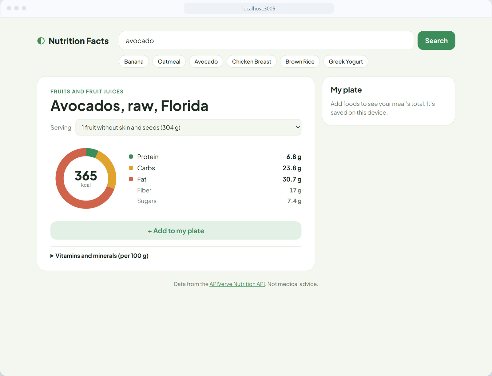

# Nutrition Facts | APIVerve Template

[](LICENSE)
[](package.json)
[](tsconfig.json)
[](https://apiverve.com/marketplace/nutrition?utm_source=github&utm_medium=template&utm_campaign=nutrition-facts-nextjs-tutorial)

A nutrition app you can deploy in one click. Search any food, pick a real serving size, and see its calories with a ring showing how much comes from protein, carbs and fat. Add foods to your plate for a running meal total that stays on your device. It works on phones and desktops from the same code.

[](https://vercel.com/new/clone?repository-url=https%3A%2F%2Fgithub.com%2Fapiverve%2Fnutrition-facts-nextjs-tutorial&project-name=nutrition-facts&repository-name=nutrition-facts&env=APIVERVE_API_KEY&envDescription=Your%20APIVerve%20API%20key.%20Free%20to%20create%2C%20no%20card%20needed.&envLink=https%3A%2F%2Fdashboard.apiverve.com%2Fsignup%3Fapi%3Dnutrition%26utm_source%3Dvercel%26utm_medium%3Dtemplate%26utm_campaign%3Dnutrition-facts-nextjs-tutorial)



---

### Get your free API key

This template needs an APIVerve API key. **[Sign up free](https://dashboard.apiverve.com/signup?api=nutrition&utm_source=github&utm_medium=template&utm_campaign=nutrition-facts-nextjs-tutorial)**, no credit card required.

---

## Deploy in one click

Click **Deploy with Vercel** above. Vercel copies this repo to your GitHub account, asks for your `APIVERVE_API_KEY`, and gives you a live URL about a minute later.

## Run it locally

```bash
git clone https://github.com/apiverve/nutrition-facts-nextjs-tutorial.git
cd nutrition-facts-nextjs-tutorial
npm install
cp .env.example .env   # then set APIVERVE_API_KEY in .env
npm run dev
```

Open `http://localhost:3000`. To see it in a phone and a browser frame side by side, open `http://localhost:3000/showcase.html`.

## How it works

1. `components/NutritionApp.tsx` is the page: search, the food card with its serving picker, and your plate. It calls `/api/nutrition?food=...`.
2. `app/api/nutrition/route.ts` checks the input, then calls Nutrition. Your API key stays on the server and never reaches the browser. Answers are cached for a day, and cached answers don't count against the rate limit.
3. The API returns values per 100 g with a list of serving sizes, so the page scales them to the serving you pick, and works out the calorie split (4 kcal per gram of protein and carbs, 9 for fat) for the ring. The plate is kept in `localStorage`.

Everything here works on a free key: calories, protein, fat, carbs, fiber, sugars and serving sizes come back on every plan. Paid plans add vitamins and minerals, which the card shows in a fold-out list when they’re there.

```
app/
  api/nutrition/route.ts   the server route: validates, caches, calls the API
  layout.tsx               fonts and metadata
  page.tsx
  globals.css
components/
  NutritionApp.tsx         the app
lib/
  apiverve.ts              key, rate limit, cache and the API call
public/
  showcase.html            the phone and desktop demo frame
```

### The API call

```ts
const res = await fetch('https://api.apiverve.com/v1/nutrition?food=avocado', {
  headers: { 'x-api-key': process.env.APIVERVE_API_KEY! }
});
const { data } = await res.json();
```

## Before you share your URL

Once deployed, anyone who finds your URL can use it on your API key. Each visitor can make 10 uncached requests a minute, and repeat lookups come from the cache, which is fine for a demo. Both are kept in memory, so they aren't shared between serverless instances. For production:

- Put the page behind your own sign-in, or
- Move the limit and cache to a shared store such as [Upstash Redis](https://upstash.com/), or
- Call the route only from your own backend.

## Ideas to extend it

- Add a daily target from the [BMI Calculator](https://apiverve.com/marketplace/bmicalculator?utm_source=github&utm_medium=template&utm_campaign=nutrition-facts-nextjs-tutorial).
- Suggest ways to burn it off with [Exercises](https://apiverve.com/marketplace/exercises?utm_source=github&utm_medium=template&utm_campaign=nutrition-facts-nextjs-tutorial).
- Scan packaged food with [Barcode Reader](https://apiverve.com/marketplace/barcodereader?utm_source=github&utm_medium=template&utm_campaign=nutrition-facts-nextjs-tutorial).

## API reference

- [Nutrition](https://apiverve.com/marketplace/nutrition?utm_source=github&utm_medium=template&utm_campaign=nutrition-facts-nextjs-tutorial): `GET https://api.apiverve.com/v1/nutrition`
- [Full documentation](https://docs.apiverve.com?utm_source=github&utm_medium=template&utm_campaign=nutrition-facts-nextjs-tutorial)

## Tech stack

- **Next.js 16** (App Router) and **React 19**, in **TypeScript**
- A **Route Handler** in `app/api/` for the server side, so the key never reaches the browser
- Deploys to Vercel as-is, with no configuration

## License

MIT. See [LICENSE](LICENSE).
